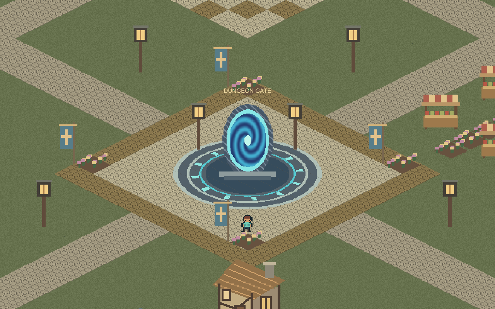
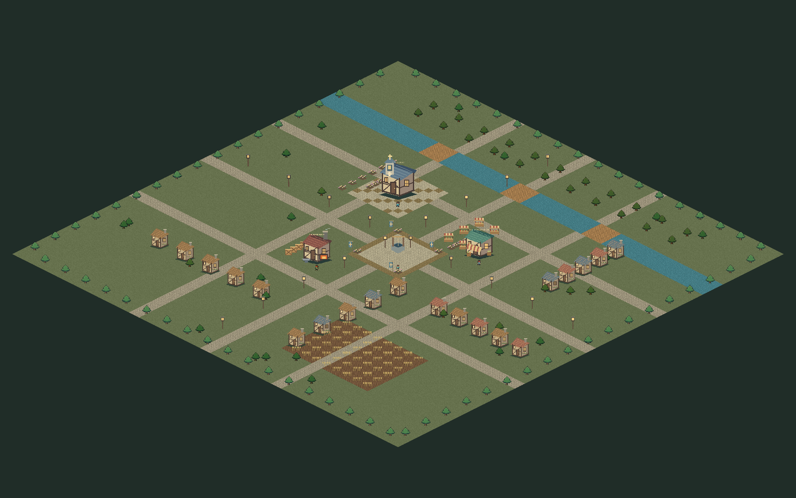

# DungeonKov

Unity로 만드는 쿼터뷰 2D 도트 액션 RPG 프로토타입입니다. 중세 마을에서 NPC와 상호작용하고, 중앙 포탈을 통해 숲 던전에 입장할 수 있습니다.

## 주요 기능

- 우클릭 이동, 장애물 우회 경로 탐색, 카메라 추적 및 줌
- 5,776개 타일로 구성된 중세 마을과 전체 지도
- 대장간의 검 강화, 교회의 치료·축복, 잡화점의 물약 판매
- 포탈을 통한 던전 입장·귀환, 마을 상태의 실행 중 유지
- 근접 공격·회피와 슬라임 3개 웨이브 전투
- Unity Scene에서 건물·NPC·시작점 배치와 설정 편집

## 실행 방법

1. 이 저장소를 clone하거나 다운로드합니다.
2. Unity Hub에서 저장소 폴더를 프로젝트로 추가합니다.
3. **Unity 6000.4.0f1**로 엽니다.
4. **Assets/Scenes/Town.unity**를 열고 Play를 누릅니다.

빌드 결과물과 Unity 캐시는 저장소에 포함하지 않습니다. **Mosslight → Build town** 메뉴로 Windows 실행 파일을 생성할 수 있습니다.

## 조작

| 입력 | 동작 |
| --- | --- |
| 우클릭 | 이동 |
| NPC / 포탈 좌클릭 | 접근 후 상호작용 |
| 마우스 휠 | 마을 카메라 줌 |
| M | 마을 지도, 지도 우클릭으로 장거리 이동 |
| 던전 좌클릭 / J | 근접 공격 |
| 던전 휠 버튼 / Space | 회피 |
| Esc | 대화 닫기 / 던전 일시정지 |

던전 일시정지·승리·패배 화면의 **RETURN TO TOWN**으로 귀환합니다.

## 코드 구조

- `Assets/Scripts/TownGame.cs`: 마을 이동·지도·대화·거래
- `Assets/Scripts/TownNpc.cs`: NPC 이름·대사·서비스 설정
- `Assets/Scripts/TownPortal.cs`, `TownVisit.cs`: 포탈과 마을 상태
- `Assets/Scripts/MosslightGame.cs`: 던전 전투와 게임 진행
- `Assets/Editor/`: 장면 생성·편집 보조·빌드 도구
- `Assets/Town/Prefabs/`: 마을 건물·NPC·포탈 프리팹

편집 방법과 세부 조작은 [마을 안내](TOWN.md)를 참고하세요.

## 검증과 현재 한계

Windows 빌드 및 자동 검사로 NPC 접근 경로, 거래·치료·축복, 장거리 이동, 던전 입장·귀환·재입장을 확인했습니다. 장면 카메라 렌더링도 확인했습니다. 모든 UI와 실제 입력에 대한 수동 플레이 검증이 완료된 상태는 아닙니다.

- 진행 상태는 실행 중에만 유지되며 디스크 저장은 아직 없습니다.
- 마을 검 강화 수치는 던전 공격력과 아직 연결되지 않았습니다.
- 건물 내부와 장비·퀘스트 시스템은 아직 없습니다.
- 현재는 단일 프로젝트의 초기 프로토타입이며 구조 개선을 진행할 예정입니다.

## 개발 기록과 AI 활용

이 저장소의 첫 커밋은 지금까지 만든 프로토타입을 정리한 초기 스냅샷입니다. 이후 변경은 기능과 문제 해결 단위로 기록합니다.

현재 프로토타입은 사용자 요구사항을 바탕으로 AI(Codex)가 코드와 도트 에셋 생성 로직, 편집 도구를 작성한 상태입니다. 향후 직접 수정·검토·검증한 작업을 구분해 기록할 예정입니다.

주요 개발 과정:

1. 쿼터뷰 전투 시제품 및 마우스 이동 구현
2. 실행 중 생성하던 맵을 편집 가능한 Scene으로 전환
3. 중세 마을과 NPC 서비스 추가
4. 마을 면적 16배 확장과 경로 탐색 최적화
5. 중앙 포탈 광장 및 던전 왕복 연결

